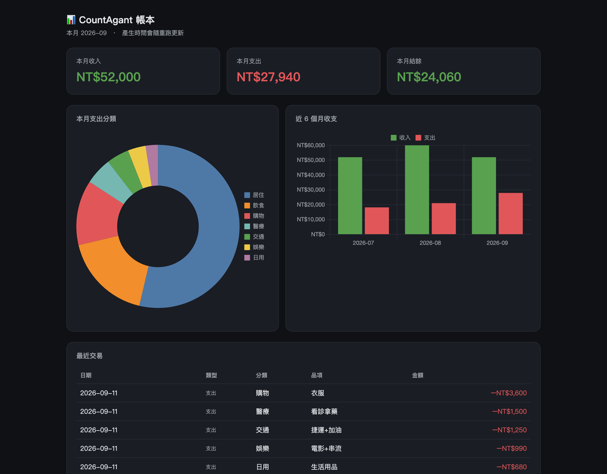

# CountAgent

[繁體中文](README.zh-TW.md)

**A personal-bookkeeper Agent Skill for Claude Code (and any agent that reads `SKILL.md`). The capture side is deliberately stupid; every judgement call is handed to the agent.**

Say "lunch 120" to Siri while you're still standing outside the shop. Say "sort it out" when you're back at your computer. Categorising, filling in the blanks, working out the budget and writing the reports all happen afterwards, without you.



<sub>Produced by <code>python3 skills/countagent/scripts/dashboard.py --demo</code>. Every number in the screenshot is demo data.</sub>

This runs on your own machine, so there is nothing hosted to click. The closest thing to a live demo is one command — no ledger, no account, no setup:

```bash
git clone https://github.com/seanlu2006/CountAgent.git
cd CountAgent
python3 skills/countagent/scripts/dashboard.py --demo
```

## Why I built it

Expense apps are everywhere, and I've quit every one of them inside two weeks. The problem was never the feature list. It was **the two seconds at the point of spending**: open the app, wait for it to load, pick a category, pick a payment method, fill in the fields. Every entry asks you to tidy up the data on the app's behalf first. Standing in a doorway, in the rain, halfway through a conversation, nobody wants to do that.

So I didn't try to build a better expense app. I asked a different question: **what if recording an expense collapsed into one spoken sentence, and everything clever happened afterwards?**

## The idea: move the intelligence out of the interface and into the agent

A normal expense app puts its intelligence in the **interface** — dropdowns, category trees, tags, rule engines. The price is that you have to think in the shape of the database schema. You aren't recording an expense; you're populating a table.

CountAgent splits capture from interpretation completely:

| | Capture | Interpretation |
|---|---|---|
| Where | iPhone, anywhere | Computer, whenever |
| Who | You, one sentence, two seconds | The agent, unattended |
| How smart | **As dumb as possible** — append plain text to a file | **Smart** — semantic parsing and common sense |
| Failure rate | Near zero; works with no signal | Higher, but every mistake is fixable later and none of them block capture |

**The dumb capture side is a design decision, not laziness.** It does exactly one thing: append a line of text to a plain text file. No fields, no menus, no login, no network request. Too dumb to break — and too dumb to give me an excuse not to use it.

**All the tedious judgement calls go to the agent.** Turning "late-night snack 97, yesterday" into a nine-column row means inferring the date (which day was "yesterday"), the type, the category (a snack counts as Food) and the payment method (unstated, so the default applies) — and then writing a short description. That is exactly where an LLM is strong and where a keyword-matching rule engine is most brittle — a keyword table never covers the way people actually talk.

**And the rules are prose, not code.** The agent's entire behaviour is defined in [`SKILL.md`](skills/countagent/SKILL.md) plus a few reference pages. They cover how to infer a category, when to stop and ask instead of guessing, why an investment is neither income nor expense, and which suspicious categories to re-check after an invoice import. Two examples of the kind of rule it holds:

> If he doesn't say how he paid, default to credit card — he rarely uses cash. "Paid cash" means cash; LINE Pay, JKOPay or EasyWallet means mobile payment; a transfer, a remittance or a repayment means bank or transfer.

> Invoice categories are guessed from the shop name and may be wrong. After an import, go through the doubtful ones yourself — something bought at a convenience store isn't necessarily Food — and ask once whether to adjust them; when he confirms, drop the "category unconfirmed" marker from the note.

Changing a rule means editing a sentence, not rewriting a parser. The rules can drift with my habits instead of with my willingness to touch the code.

The practical difference: recording an expense goes from "open app → pick category → type amount → save" to "say one sentence to Siri", and sorting it out goes from "never" to "say 'sort it out' when I have a minute".

## What it does

- **One-sentence capture** — an iOS Shortcut plus Siri appends one line to `inbox.txt` in iCloud. It works offline, and if you set the Shortcut up to prepend a timestamp, the agent uses that as the date.
- **Semantic entry** — the agent reads the backlog line by line, infers the date, the type, the category and the payment method, writes a short description, and appends a nine-column row to the ledger.
- **Duplicate protection** — iCloud sync can hand back lines that were already processed, so every raw line is kept in an archive file and compared verbatim; anything already seen is skipped. A second check catches the human version: the same amount for the same thing on the same day (two "lunch 90"s) is recorded once, and the agent asks whether it really was two meals.
- **Bank statement import** — a CSV from any bank or card: columns, date order and decimal format detected; card repayments become transfers; re-imports and things you already logged are skipped.
- **E-invoice import** — in Taiwan, purchases can be attached to a phone-barcode carrier and retrieved later. Two routes, one ledger: a CSV export from the carrier app (column names matched by keyword, comma or tab, Big5 and UTF-8 both decoded automatically) or the Ministry of Finance carrier API. Both deduplicate on invoice number.
- **Billing-cycle months** — a "month" runs from the day after the credit card statement closes to the next closing day (set `cycle_day` to your closing day, or 0 for calendar months), so a budget month matches the bill you actually pay. Quarters are three billing cycles.
- **Reports** — a monthly summary, a quarterly statement (savings rate, budget vs actual, fixed vs variable spending) and an interactive HTML dashboard: daily spending against the daily budget, category bars against their budgets, an eating-out-only toggle, a transactions table and a ⌘K command palette. One self-contained file, no libraries, works offline.
- **Cooking cost tracking** — records how fast ingredients get used up, so I can compare what cooking actually costs per meal against what eating out costs.

## Quick start

You need [Claude Code](https://claude.com/claude-code) (or another agent that loads Agent Skills) and Python 3.8+. The scripts use the standard library only — **nothing to `pip install`**. English and Traditional Chinese are built in; any currency.

**Install the skill:**

```bash
git clone https://github.com/seanlu2006/CountAgent.git
mkdir -p ~/.claude/skills
ln -s "$PWD/CountAgent/skills/countagent" ~/.claude/skills/countagent
```

(Or copy the `skills/countagent` folder there instead of linking it.)

**Set up, from any folder:** open Claude Code and say *"set up CountAgent"*. It asks a handful of questions in one go — language, currency, whether a "month" should follow your card statement, how you usually pay — and creates your data folder (default `~/CountAgent/data`) with a ledger, a budget, a profile of your habits and a category list. Your data never lives inside the skill folder, so updating the skill can't touch it.

**Then just talk to it. Recording an expense takes no command at all:**

> **You:** lunch 12
>
> **Agent:** ✅ #42 2026-05-31 | expense 12 | Dining · lunch (card) — Dining 148 of 200 this month.

Ask "how much did I spend this month?", "show me the dashboard", or "sort out my inbox".

**Reports** (the agent runs these for you; they also work by hand):

```bash
S=~/.claude/skills/countagent/scripts
python3 $S/report.py                 # current month (or billing period)
python3 $S/report.py 2026-08         # a specific one
python3 $S/quarterly.py 2026Q3 --md  # quarterly statement, also saved as markdown
python3 $S/dashboard.py              # reports/dashboard.html, opened on macOS
python3 $S/dashboard.py --demo       # made-up data, never reads your ledger
```

**Phone capture** is optional, but it's the point of the whole design: a phone action that appends one line to a synced text file. Step-by-step for iPhone (Shortcuts + Siri) and Android is in [`references/inbox.md`](skills/countagent/references/inbox.md).

**Bank and card statements**: hand the agent a CSV export from your bank. It reads the columns, date order and number format by itself, turns card repayments into transfers so nothing counts twice, and skips anything you already logged by hand. Details: [`references/bank-import.md`](skills/countagent/references/bank-import.md).

**Taiwan e-invoice import** (CSV export or the Ministry of Finance carrier API): [`references/einvoice-tw.md`](skills/countagent/references/einvoice-tw.md).

## How it works

```
[capture]  one sentence to Siri on the iPhone
    └─▶ appended to inbox.txt in iCloud (plain text, one line per entry, timestamped)
               │  iCloud syncs it across
               ▼
[parse]    the Claude Code agent reads inbox.txt
    ├─▶ compares each raw line against inbox_archive.txt and skips duplicates
    └─▶ interprets the rest line by line against SKILL.md and your profile.md
               │
[classify] category inferred from categories.md; payment method from your settings and profile
               │
[store]    one row appended to ledger.csv (nine columns; history is never reordered)
               │  inbox emptied, raw lines moved into the archive
               ▼
[report]   report.py     — month or billing period, prints to the terminal
           quarterly.py  — quarter, reads budget.md; --md also writes a markdown copy
           dashboard.py  — writes reports/dashboard.html

The other way in:
carrier CSV / Ministry of Finance API ─▶ categorize.py guesses a category from the shop name ─▶ the same ledger.csv
                                         (flagged "category unconfirmed" for the agent to review later)
```

`ledger.csv` is the single source of truth: plain CSV. It opens in Excel, it's trivial to back up or migrate, and it's tied to no app and no database.

## Project layout

```
CountAgent/
├── skills/countagent/             # the skill — this folder is what you install
│   ├── SKILL.md                   # agent behaviour, written as prose
│   ├── references/                # setup, phone inbox, reports & budget, Taiwan e-invoices
│   ├── scripts/
│   │   ├── cfg.py                 # finds your data folder and settings (--where)
│   │   ├── setup.py               # first-run setup, never overwrites
│   │   ├── report.py              # period summary
│   │   ├── quarterly.py           # quarterly statement
│   │   ├── dashboard.py           # HTML dashboard (single file, no libraries)
│   │   ├── period.py              # calendar or billing-cycle months
│   │   ├── budget.py              # budget.md parser (English or Chinese headings)
│   │   ├── i18n.py                # en / zh-TW text
│   │   ├── import_bank.py         # bank / card statement CSV import (any bank)
│   │   ├── import_csv.py          # Taiwan e-invoice CSV import
│   │   ├── fetch_invoices.py      # Taiwan Ministry of Finance carrier API
│   │   └── categorize.py          # shop name → category for the imports
│   └── templates/{en,zh-TW}/      # starting files, all made-up numbers
├── docs/dashboard.png             # the screenshot above
└── data/, reports/                # the maintainer's own ledger — gitignored, never published
```

Your data folder holds `ledger.csv`, `config.json`, `budget.md`, `profile.md`, `categories.md` and the inbox archive. Find it with `python3 skills/countagent/scripts/cfg.py --where`; override it with `COUNTAGENT_DATA=/path`.

## Known limitations

- **It needs an agent.** This is not a standalone app. Without Claude Code (or another skill-capable agent) you're left with a few Python scripts that read a CSV, and the bookkeeping half doesn't run at all.
- **The LLM doesn't get everything right.** Genuinely ambiguous lines ("that 300") are left in the inbox for me to confirm rather than guessed at. E-invoice categories are **guessed from the shop name**, so household goods bought at a convenience store land under Food and need a review pass.
- **One person, one machine.** It leans on iCloud file sync: no shared ledgers, no real-time multi-device sync. Sync lags, and it can hand back old lines — which is what the archive comparison is there for.
- **Phone capture is DIY.** The iPhone recipe is written out; on Android you wire up your own "append one line to a synced file" action. That is genuinely all it is; the layer was designed to be that thin.
- **Taiwan only: the Ministry of Finance API needs an AppID**, and the application page is often down for maintenance, so CSV import is the route I actually use.
- **Fixed vs variable spending is by label.** A row counts as fixed when its note contains `fixed` (or 固定). The agent adds the label for recurring charges listed in your profile; anything else unlabelled shows up as variable.

## License

[MIT](LICENSE). Take it, change it, use it.
