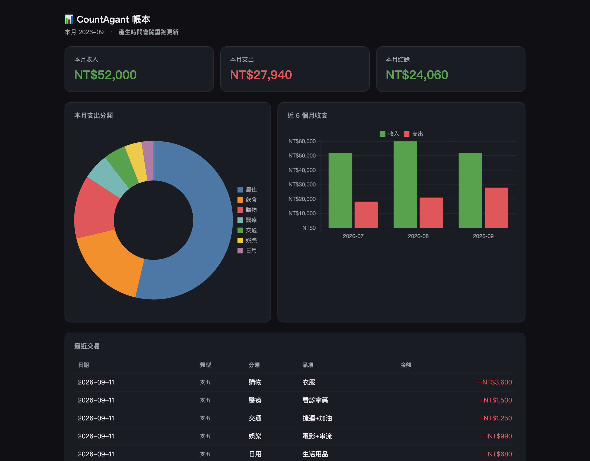

# CountAgent

[English](README.md)

**一個給 Claude Code(或任何讀得懂 `SKILL.md` 的 agent)用的個人記帳 Skill —— 捕捉端笨到極點，判斷端全交給 AI。**

在外面對 Siri 說一句「午餐 120」，回到電腦說一聲「整理」，
剩下的分類、補欄位、算預算、產報表，全部由 agent 完成。



<sub>上圖由 `python3 skills/countagent/scripts/dashboard.py --demo` 產生，資料全為示範假資料。</sub>

這東西跑在自己的電腦上，沒有線上版可以點。最接近 live demo 的就是一行指令——不用帳本、不用註冊、不用設定：

```bash
git clone https://github.com/seanlu2006/CountAgent.git
cd CountAgent
python3 skills/countagent/scripts/dashboard.py --demo
```

---

## 為什麼做這個

記帳 App 滿街都是，但我每次都撐不過兩週。問題不在功能不夠，
而在**當下那兩秒**：要開 App、等載入、選分類、選付款方式、填欄位——
等於每記一筆，都要先幫 App 把資料整理好。人在店門口、雨中、跟朋友講話時，不會想做這件事。

所以我不想再做一個「更好用的記帳 App」。我想試的是：
**如果記錄這件事可以退化成「講一句話」，聰明的部分全部由 AI 事後補，會怎麼樣？**

## 核心概念：把智慧從 App 移到 Agent

一般記帳 App 把智慧放在**介面**：下拉選單、分類樹、標籤、規則引擎。
智慧放在介面的代價，是使用者必須配合資料庫的 schema 思考——
你不是在「記帳」，你是在「替資料表填欄位」。

CountAgent 反過來，把捕捉端和整理端徹底切開：

| | 捕捉 | 整理 |
|---|---|---|
| 在哪 | iPhone，任何地方 | 電腦，有空時 |
| 誰做 | 你，兩秒一句話 | Agent，全自動 |
| 要多聰明 | **笨到極點**（純文字附加到一個檔案） | **很聰明**（語意解析 + 常識判斷） |
| 失敗率 | 幾乎為零，沒有網路也能用 | 較高，但出錯都能事後修，也不會擋住記錄 |

**捕捉端笨，是刻意的設計，不是偷懶。**
它只做一件事：把一行字附加到一個純文字檔。沒有欄位、沒有選單、沒有登入、沒有網路請求。
笨到不可能故障，也就笨到讓人沒有藉口不用。

**判斷的苦工，全部推給 agent。**
把「昨天宵夜 97」變成一列九欄的帳，需要推斷日期（昨天是幾號）、收支類型、
分類（宵夜屬飲食）、付款方式（沒講就用預設）、品項描述。
這正好是 LLM 擅長、而傳統規則引擎最脆弱的地方——關鍵字表永遠寫不完使用者的講法。

**而規則本身是自然語言，不是程式碼。**
Agent 的完整行為定義寫在 [`SKILL.md`](skills/countagent/SKILL.md) 與幾頁參考文件裡：
怎麼推斷分類、什麼情況該反問、投資為什麼不算支出、發票匯入後要主動複查哪些可疑分類。
規則大概長這樣：

> `payment` → **沒講就預設 `信用卡`**(Sean 很少用現金);出現「付現/現金」才記 `現金`,
> 「Line Pay/街口/悠遊付」→ `行動支付`,「轉帳/匯款/還款」→ `銀行` 或 `轉帳`。

> **發票分類是用店名猜的,可能不準**。匯入後主動幫 Sean 掃一遍可疑分類(例:超商買的不一定是飲食),
> 問一句要不要調整,他確認後把 `note` 的「分類待確認」字樣拿掉。

要改規則就是改一句中文，不必重寫 parser。
記帳規則因此能跟著生活習慣演化，而不是每次都要動到程式。

對使用者的實際差別：
記一筆的成本從「開 App → 選分類 → 填金額 → 存檔」變成「對 Siri 講一句話」；
整理的成本從「永遠不會做」變成「有空時說一聲『整理』」。

## 核心功能

- **一句話捕捉** — iOS 捷徑 + Siri 語音把一句話寫進 iCloud 的 `inbox.txt`，離線可用；捷徑有加時間戳的話，agent 就拿它當日期
- **語意解析建帳** — agent 逐行判讀，推斷日期、收支類型、分類、付款方式與品項，append 一列九欄的帳
- **去重防呆** — iCloud 同步可能把已處理的舊行帶回來，以歸檔檔逐字比對後跳過；同一天同金額、同品項（兩筆「午餐 90」）先只記一筆，再問是不是真的兩餐
- **銀行對帳單匯入** — 任何銀行或信用卡的 CSV:欄位、日期順序、小數格式自動判讀;卡費還款記成轉帳;重複匯入和手動記過的會跳過
- **電子發票匯入** — 支援載具匯出的 CSV（欄名不拘、Big5/UTF-8 自動判讀、逗號或 tab 皆可）與財政部載具 API，用發票號碼去重
- **帳期月** — 「一個月」照信用卡結帳日切（設定 `cycle_day` 為你的結帳日；0 = 日曆月），預算月就對得上實際要繳的那期帳單；季＝三個帳期
- **多維報表** — 月報、季度財報（儲蓄率、預算 vs 實際、固定 vs 變動支出）、互動 HTML 儀表板：每日支出對照每日預算、分類 vs 預算、只看外食、交易表、⌘K 指令面板。單一檔案、不載任何函式庫、離線可用
- **自煮成本追蹤** — 記錄食材消耗速度，換算自煮與外食的真實單餐成本

## 快速開始

需要 [Claude Code](https://claude.com/claude-code)(或其他支援 Agent Skills 的 agent)與 Python 3.8+。
腳本只用標準函式庫,**不需 pip 安裝任何套件**。內建繁體中文與英文,幣別不限。

**安裝 skill**:

```bash
git clone https://github.com/seanlu2006/CountAgent.git
mkdir -p ~/.claude/skills
ln -s "$PWD/CountAgent/skills/countagent" ~/.claude/skills/countagent
```

(不想用連結,直接把 `skills/countagent` 資料夾複製過去也行。)

**首次設定(在任何資料夾)**:打開 Claude Code 說「幫我設定 CountAgent」。
它會一次問完幾個問題——語言、幣別、「一個月」要不要跟信用卡結帳日走、平常怎麼付錢——
然後建好你的資料夾(預設 `~/CountAgent/data`):帳本、預算、個人習慣、分類表。
資料不放在 skill 資料夾裡,所以更新 skill 不會動到你的帳。

**之後直接講話就好,記帳不需要任何指令**:

> 你:午餐 120
>
> Agent:✅ #42 2026-05-31 | 支出 120 | 飲食 · 午餐(信用卡)。本月飲食已花 3,180。

問「這個月花多少」「開報表」「整理」都行。

**報表**(agent 會幫你跑,手動也可以):

```bash
S=~/.claude/skills/countagent/scripts
python3 $S/report.py                 # 本期月報
python3 $S/report.py 2026-08         # 指定帳期
python3 $S/quarterly.py 2026Q3 --md  # 季報,另存 markdown
python3 $S/dashboard.py              # 產生 reports/dashboard.html(mac 會自動開啟)
python3 $S/dashboard.py --demo       # 假資料,不讀你的帳本
```

**手機隨手記**(選用,但這是整套設計的重點):手機上一個「附加一行字到同步文字檔」的動作。
iPhone(捷徑 + Siri)與 Android 的步驟在 [`references/inbox.md`](skills/countagent/references/inbox.md)。

**銀行與信用卡對帳單**:把銀行匯出的 CSV 丟給 agent。欄位、日期順序、小數格式它自己認;卡費還款記成轉帳不重複算;手動記過的會跳過並列出來問你。說明:[`references/bank-import.md`](skills/countagent/references/bank-import.md)。

**台灣電子發票匯入**(CSV 匯出或財政部載具 API):[`references/einvoice-tw.md`](skills/countagent/references/einvoice-tw.md)。

## 技術架構

```
[捕捉] iPhone / Siri 一句話
   └─▶ 附加到 iCloud inbox.txt（純文字，一行一筆，帶時間戳）
              │  iCloud 自動同步
              ▼
[解析] Claude Code agent 讀 inbox.txt
   ├─▶ 比對 inbox_archive.txt 去重
   └─▶ 依 SKILL.md 與你的 profile.md 逐行判讀語意
              │
[分類] 對照 categories.md 推斷分類，用設定與 profile 補付款方式
              │
[儲存] append 一列到 ledger.csv（九欄，永不重排歷史列）
              │  清空 inbox、原始行存進 archive
              ▼
[報表] report.py      — 月報（日曆月或信用卡帳期），印在終端機
       quarterly.py   — 季報，讀 budget.md；加 --md 另存 markdown
       dashboard.py   — 產生 reports/dashboard.html

另一條進帳路徑：
電子發票 CSV / 財政部 API ─▶ categorize.py 依店名猜分類 ─▶ 同一份 ledger.csv
                              （標記「分類待確認」，由 agent 事後複查）
```

`ledger.csv` 是唯一的事實來源：純 CSV、可用 Excel 直接開、易備份與遷移，
不綁任何 App 或資料庫。

## 專案結構

```
CountAgent/
├── skills/countagent/             # skill 本體——安裝的就是這個資料夾
│   ├── SKILL.md                   # Agent 行為定義(自然語言寫的規則)
│   ├── references/                # 首次設定、手機收件匣、報表與預算、台灣發票
│   ├── scripts/
│   │   ├── cfg.py                 # 找資料夾與設定(--where)
│   │   ├── setup.py               # 首次設定,不覆蓋既有檔
│   │   ├── report.py              # 月報
│   │   ├── quarterly.py           # 季報
│   │   ├── dashboard.py           # HTML 儀表板(單一檔、不載函式庫)
│   │   ├── period.py              # 日曆月或信用卡帳期
│   │   ├── budget.py              # budget.md 解析(中英標題皆可)
│   │   ├── i18n.py                # 中英文字
│   │   ├── import_bank.py         # 銀行 / 信用卡對帳單 CSV 匯入(任何銀行)
│   │   ├── import_csv.py          # 電子發票 CSV 匯入
│   │   ├── fetch_invoices.py      # 財政部載具 API
│   │   └── categorize.py          # 店名 → 分類
│   └── templates/{en,zh-TW}/      # 起始檔案,數字全是假的
├── docs/dashboard.png             # 上面那張截圖
└── data/, reports/                # 維護者自己的帳本——gitignore,永不公開
```

你的資料夾裡有 `ledger.csv`、`config.json`、`budget.md`、`profile.md`、`categories.md` 與收件匣歸檔。
用 `python3 skills/countagent/scripts/cfg.py --where` 查位置;環境變數 `COUNTAGENT_DATA=/路徑` 可覆蓋。

## 已知限制

- **需要 agent**：這不是獨立 App。沒有 Claude Code(或其他支援 skill 的 agent)的話，剩下的只是幾支能讀 CSV 的 Python 腳本，記帳那一半不會動。
- **LLM 判讀不保證全對**：語意模糊的句子（「那個 300」）會被留在收件匣等人確認；電子發票是**用店名猜分類**，超商買日用品就會歸錯，需要事後複查。
- **單人單機**：靠 iCloud 檔案同步，沒有多人共帳、沒有多裝置即時同步。同步有延遲，也可能把舊行帶回來（靠歸檔比對去重處理）。
- **手機捕捉端要自己接**：iPhone 有現成步驟;Android 要自己做一個「附加一行字到同步檔案」的動作——不過也就這樣而已，這層本來就設計得很薄。
- **(台灣)財政部 API 需要 AppID**，申請頁常在維護，所以目前主用 CSV 匯入那條路。
- **固定 vs 變動看標記**：`note` 含「固定」(或 fixed)才算固定。profile 裡列的固定支出 agent 會自動標;沒標到的會被算成變動。

## 授權

2026-11-03 起改用 [PolyForm Shield 1.0.0](LICENSE)，屬於原始碼公開（source-available），不是 OSI 認可的開源授權。使用、修改、拿到工作上用都可以；唯一不行的是拿它提供跟它競爭的產品，例如販售它的複本或稍微改過的版本，收費或免費都一樣。再散布時請保留 LICENSE 檔和裡面的聲明行。`mit-final` 標籤（含）以前的版本以 MIT 釋出，那些版本維持 MIT。
